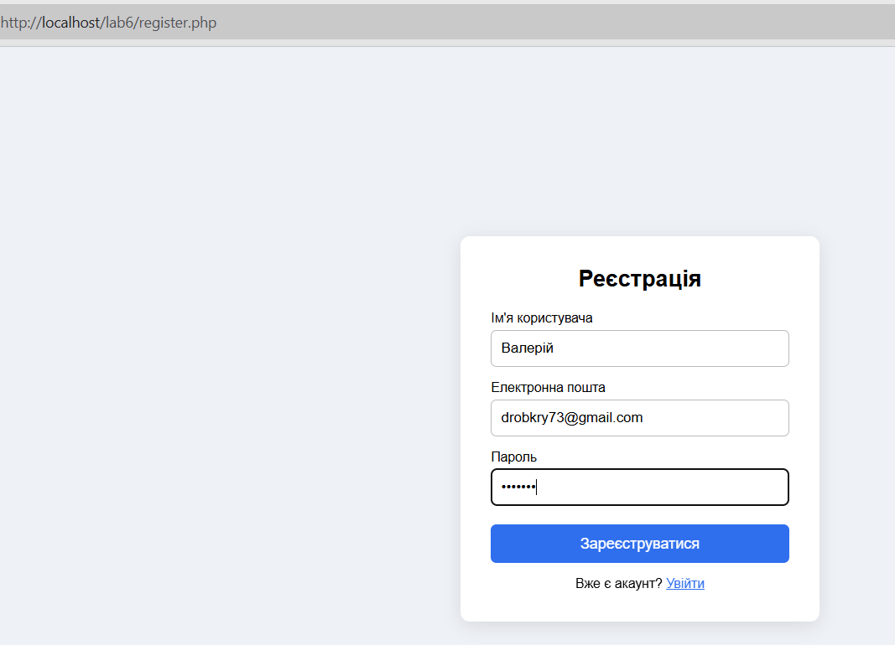
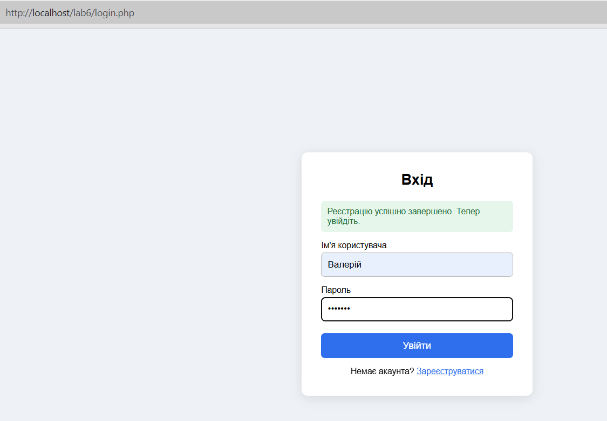
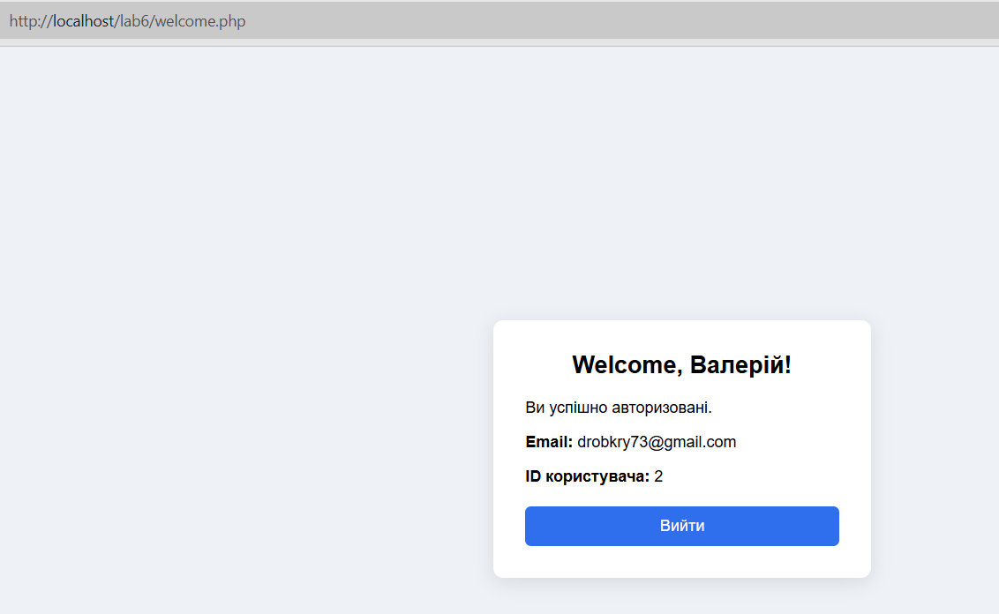
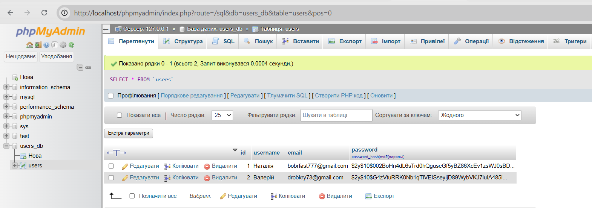

# Лабораторна робота №6 — PHP + MySQL (реєстрація/авторизація)

## Запуск (XAMPP)
1. Встановіть XAMPP (https://www.apachefriends.org), запустіть **Apache** і **MySQL**.
2. Скопіюйте папку проєкту в `C:\xampp\htdocs\lab6` (macOS/Linux: `/opt/lampp/htdocs/lab6`).
3. Відкрийте http://localhost/phpmyadmin → **Імпорт** → оберіть `dump.sql` → **Вперед**.
4. За потреби змініть логін/пароль БД у `config.php` (для XAMPP: root, пароль порожній).
5. Відкрийте http://localhost/lab6/register.php

## Файли
- dump.sql — створення БД `users_db` і таблиці `users`
- config.php — підключення до БД, сесія, функції хешування
- register.php — реєстрація
- login.php — авторизація
- welcome.php — захищена сторінка
- logout.php — вихід
- index.php, style.css

## Скриншоти

### Реєстрація

### Авторизація

### Захищена сторінка Welcome

### Таблиця users у базі даних (пароль захешовано)

