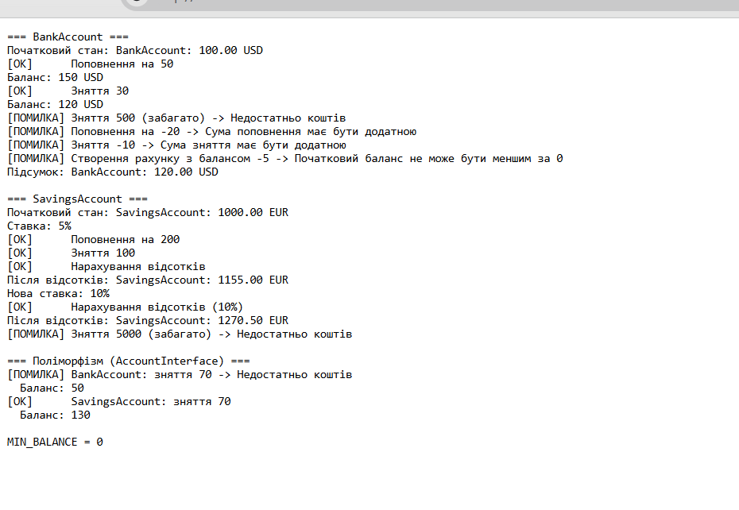

# Лабораторна робота № 5. Об'єктно-орієнтоване програмування в PHP

## Завдання

Реалізувати систему класів для роботи з банківськими рахунками: кожен рахунок має валюту, можливість поповнення та зняття коштів. Помилки (наприклад, недостатньо коштів) обробляються за допомогою винятків.

## Структура проєкту

| Файл | Опис |
|---|---|
| `AccountInterface.php` | Інтерфейс з методами `deposit()`, `withdraw()`, `getBalance()` |
| `BankAccount.php` | Базовий клас рахунку: константа `MIN_BALANCE`, властивості `balance` і `currency`, обробка винятків |
| `SavingsAccount.php` | Накопичувальний рахунок: успадковує `BankAccount`, статична властивість `$interestRate`, метод `applyInterest()` |
| `index.php` | Клієнтський код: тестування рахунків і обробка винятків |

## Реалізація

- **Інтерфейс** `AccountInterface` визначає спільний контракт для всіх рахунків.
- **`BankAccount`** реалізує інтерфейс. Виняток `Exception` викидається, якщо:
  - сума поповнення або зняття не додатна;
  - сума зняття перевищує баланс («Недостатньо коштів»);
  - початковий баланс менший за `MIN_BALANCE`.
- **`SavingsAccount`** наслідує `BankAccount`. Статична ставка `interestRate` спільна для всіх накопичувальних рахунків, а `applyInterest()` додає до балансу відсоток від поточної суми.
- **Поліморфізм:** об'єкти обох класів обробляються через тип `AccountInterface`.

## Результат виконання

